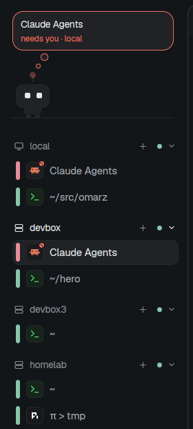

# Machines — a herdr-app layout

A sidebar for running agents on several machines with
[herdr-app](https://herdr.dev) and herdr-core (`hc`). Every machine is a
foldable header with each of its terminals under it in one flat list, asking
first; a small bot above it acts out what needs you; one line at the bottom
starts an agent on any machine.



Two mods and a layout:

- **`machine-sidebar`** — the machine list, the dispatcher line and Restore.
- **`sidebar-bot`** — the bot and its thought cloud.
- **`layouts/machines.json`** — the bot (160 px) above the list in a 220 px
  sidebar, terminals beside it.

## Install

```bash
git clone https://github.com/Omarabdul3ziz/herdr-machine-sidebar.git
cd herdr-machine-sidebar
cp -r mods/machine-sidebar mods/sidebar-bot ~/.config/herdr-app/mods/
cp layouts/machines.json ~/.config/herdr-app/layouts/
herdr-app do layout.switch --name machines
```

Merge `keys.json` into `~/.config/herdr-app/keys.json` for the keys below.
Add your other machines with `hc machine add` (or Settings → Machines); one
space per machine is assumed.

## Use

- **Rows**: asking first (red bar), working (blue), then done, idle and shells
  (green). Click to show; hover for ×; drag onto another row of the same
  machine to move its tab. Click a machine's header to fold it.
- **`ctrl+tab` / `ctrl+shift+tab`**: every row, in the order shown.
- **`ctrl+shift+d`** (or click the line): start an agent.
  `@devbox #pi ~/src/app fix the login bug` — `@` a machine (`local` or any
  `hc machine`), `#` any agent herdr-app knows that is installed there, a
  path; the rest is its first message. Defaults: local, claude, home. No AI
  parses it. 🎙 dictates with [voxtype](https://voxtype.io) if installed.
  Scripts can send a line: `herdr-app do "machine-sidebar.send @devbox hi"`.
- **Restore**: after a reboot, agents the line started come back as shells and
  their machine shows **Restore N**; one click resumes them (claude and pi by
  session id, omp its folder's latest session).
  `herdr-app do machine-sidebar.restore` does every machine.
- **`ctrl+shift+y`**: hide or show the bot. Click it to jump to what needs you.

## Restore every Claude, not only the dispatched ones

`hooks/claude-hc-resume.sh` is a Claude Code hook: in an hc terminal it saves
`claude --resume <session id>` on the terminal when a session starts and clears
it when you quit on purpose. Copy it to `~/.claude/hooks/` and add to
`~/.claude/settings.json` (needs `jq`):

```json
"hooks": {
  "SessionStart": [{ "hooks": [{ "type": "command", "command": "sh ~/.claude/hooks/claude-hc-resume.sh start" }] }],
  "SessionEnd":   [{ "hooks": [{ "type": "command", "command": "sh ~/.claude/hooks/claude-hc-resume.sh end" }] }]
}
```

## What it runs

The mods run `hc label` and `hc send` (resume labels and Restore),
`printenv HOME` on a remote machine (to expand `~`), and `voxtype record` /
`voxtype status` (dictation). Restore only ever types one of
`claude --resume <id>`, `pi --session-id <id>` or `omp --continue`. They read
no files and make no network calls.

MIT licensed.
