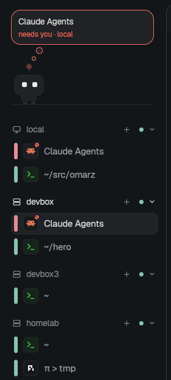

# Machines

A calm sidebar for people who run agents on several machines. Every machine
herdr-core reaches is a foldable header with each of its terminals under it in
one flat list, the ones asking for you first. A small bot above the list acts
out what needs you, and one line at the bottom starts an agent on any machine
without leaving the keyboard.

## What you see

Left to right: a 220 px sidebar column, then the shown tab (`content.tab:
"active"`) in rounded pane frames.

The sidebar, top to bottom:

1. **The bot** (`sidebar-bot`, 160 px block, drags the window). A floor line
   near the bottom; a 44×58 robot standing on it: antenna with a round light, a
   rounded head with two eyes, a small body and two feet, all in the theme's
   `raised` and `border` colors. Above it, a thought cloud across the strip
   (rounded 14, `raised`), with two small round puffs trailing down to the head.
2. **Machines** (`machine-sidebar`, the rest). One section per machine:
   `local` first, then each `hc machine`. A header row: monitor icon (local)
   or server icon, the name, `+` (new tab there), a green dot when connected
   (else "offline"), a chevron. Under it, one 32 px row per live terminal:
   a 5×24 bar in its state color, `↳` for a sub-agent, the program's icon tile
   (with a status dot when not idle), then the tab's name if someone named it,
   else the shell's folder (`~/src/app`), else the program's title.
3. **The line**: a 32 px box that reads `@machine #agent ~/folder what to do`
   and `ctrl+shift+d`.
4. **Settings** at the bottom.

## How it behaves

- **Order and colors.** Each machine lists asking terminals first (red bar,
  `ansi1`), then working (blue, `ansi4`), then everything else: done, idle and
  shells (green, `ansi2`). A terminal asks when its agent reports `blocked` or
  its title says "N awaiting input"; it works when it reports `working` or a
  Claude title starts with a braille spinner.
- **Rows.** Click shows the terminal. Hover shows × (closes the tab when the
  terminal is its only pane, else the pane). Dragging a row onto another of
  the same machine moves its tab there. Right click opens the tab menu.
- **Headers.** Click folds the machine; folded, it shows its row count and a
  dot in its most urgent state. `+` opens a tab there.
- **Ctrl+Tab / Ctrl+Shift+Tab** step through every row in the order shown.
- **The line** (click it or `ctrl+shift+d`) opens a 640 px dialog: a textarea
  that grows to 10 rows, chips under it showing where the line goes
  (`on devbox · agent pi · in ~/src/app`) or a red reason it can't, Enter to
  send, Shift+Enter for a new line, Esc to close, 🎙 to dictate with voxtype
  (red "listening — click to stop" while recording, "… writing" while it
  transcribes). Parsing has no AI: leading `@machine`, `#agent` and a path in
  any order; the rest is the first message. Defaults: local, claude, home.
  `#agent` is any agent herdr-app knows for that machine; one not installed
  there is refused. The agent opens in a new tab named after the first words.
- **Restore.** claude and pi start with a session id the mod picks, omp
  resumes the folder's latest session; each gets `resume=<command>` as an hc
  label. A reboot brings the terminal back as a shell; its machine's header
  then shows "Restore N", which types the command in again.
- **The bot.** Asleep (eyes are lines, `z z z`, dimmed) when nothing runs; at
  a tiny laptop whose bar fills faster with more agents while they work;
  antenna pulsing red when one needs you; sparkles when one is done. Every
  1.2 s it may blink, glance, hop (now and then a big jump or a double hop) or
  stroll. Its head bobs. The thought cloud pops up: what needs you for ~6 s
  every ~10 s, otherwise a passing thought now and then. Click it to jump to
  the agent that needs you. `ctrl+shift+y` hides it.

## Built from

- Layout `layouts/machines.json`: a `row` of a `column` sidebar (blocks `bot`
  → `sidebar-bot`, `machines` → `machine-sidebar`) and the `main` tab block
  with `terminals-pane` headers (a shipped mod).
- `herdr` functions: `spaces`, `panes`, `terminals`, `machines`, `focused`,
  `knownAgents`, `theme`, `run`, `openOverlay` / `closeOverlay`, `props`,
  `nextCommand`, `hc`, `exec`, `home`.
- Commands: `tab.new`, `space.new`, `tab.close`, `pane.close`, `pane.focus`,
  `agent.focus`, `terminal.peek`, `terminal.kill`, `tab.move`, `app.settings`.
- Mod commands: `machine-sidebar.next|prev|compose|restore`,
  `machine-sidebar.send <line>`.
- Programs it runs: `hc label` and `hc send` (resume labels and Restore),
  `printenv HOME` on a remote machine (to expand `~`), `voxtype record` and
  `voxtype status` (dictation). It reads no files and makes no network calls.
- Art: none; the bot is boxes in theme colors, icons come from the app's
  program table and `mods/workspace-chrome/*.svg`.
- Optional `hooks/claude-hc-resume.sh`: a Claude Code hook that labels any
  Claude in an hc terminal, so Restore covers Claudes the line didn't start.

## Watch out

- herdr-app wraps the agent in the machine's shell (`zsh -ic '"$@"; exec "$0"
  -i' zsh claude …`), so read the agent from anywhere in `argv`. A lost
  terminal's `argv` is the bare shell: that, not the label, tells lost from
  quit.
- Restore types a label into a shell and anything can set labels, so it only
  types `claude --resume <id>`, `pi --session-id <id>` or `omp --continue`.
- One space per machine is assumed; the list never shows spaces.
- The mod folder is often a symlink; the app skips svgs that link outside its
  home, so the `+` and chevrons use the shipped workspace-chrome svgs.
- The `claude agents` dashboard reports no state; its title is the only clue.

## Done when

- Every machine shows with its terminals, asking first, bars red/blue/green.
- `@devbox #pi ~/src/app hello` opens a pi tab on devbox in that folder, and
  within 3 s `hc get` shows its `resume` label.
- `@nope x` shows "no machine @nope (…)" and sends nothing.
- Killing a labelled terminal's holder brings it back as a shell and its
  header shows "Restore 1"; clicking types the command.
- The bot sleeps with nothing running and its cloud pops up when an agent asks.
